# TP1-DAR2026 : Communication Client/Serveur avec les sockets TCP

**Nom et prénom :** Aicha Masmoudi

**Filière et Groupe :** LSI3.1.1

# Activité 1-1 : Première connexion Client/Serveur

## Étape 1 : Vérification de Git
J'ai vérifié que Git est installé avec la commande `git --version`.
La version installée est 2.56.0.

## Étape 2 : Vérification de Java
J'ai vérifié la version de Java avec `java --version`.
La version installée est OpenJDK 17.0.17.

J'ai ensuite créé le répertoire de travail `Aicha Masmoudi_LSI3_DevAppReparties` qui contient le projet `TP1-DAR2026`.

## Étape 3 : Création du serveur
J'ai créé le package `serverPackage` et la classe `Server`.

Résultat au lancement du serveur :

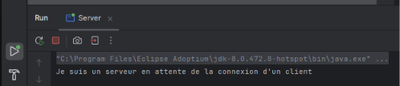

**Interprétation :** le serveur crée une socket d'écoute sur le port 1234, puis reste bloqué sur `accept()` en attendant la connexion d'un client.

## Étape 4 : Création du client
J'ai créé le package `clientPackage` et la classe `Client`.

Résultat côté client :

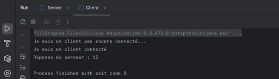

Résultat côté serveur après la connexion du client :

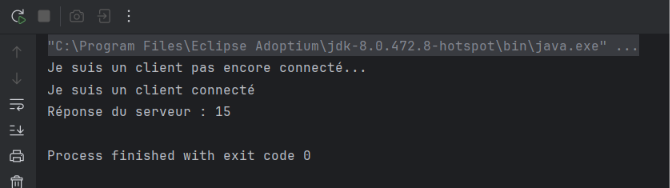

**Interprétation :** le client se connecte au serveur et lui envoie le nombre 5. Le serveur le multiplie par 3 et renvoie 15, que le client affiche. Ensuite les deux sockets se ferment.

# Activité 1-2 : Service de calculatrice

## Étape 1 : Préparation de l'espace de travail

## Étape 2 : Service de multiplication

### Test avec DataInputStream / DataOutputStream
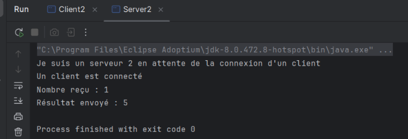

**Interprétation :** le client envoie 1, le serveur renvoie 5 (1 × 5).

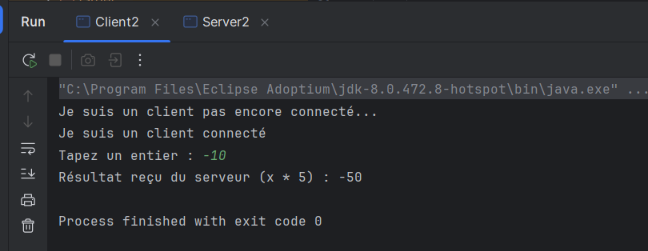

**Interprétation :** avec `writeInt`/`readInt`, le négatif -4 donne bien -20,
alors qu'avec `read()`/`write()` (un seul octet) le résultat serait faux.

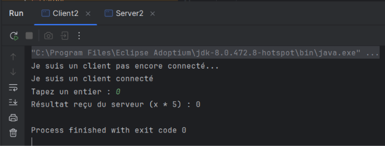

### Version avec boucle
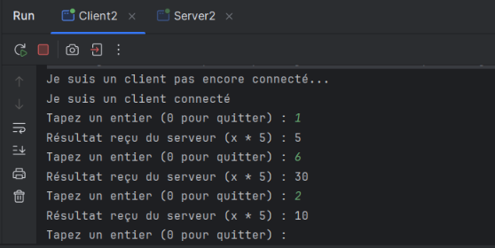
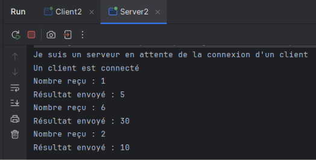

**Interprétation :** le client enchaîne plusieurs saisies, et la saisie de 0
arrête proprement la communication : les sockets sont fermés des deux côtés.

# Activité 1-3 : Amélioration du service de calculatrice

Classes utilisées : `Server3` (package `serverPackage`) et `Client3` (package `clientPackage`).

## Étape 1 : Connexion Client/Serveur sur deux machines distinctes

### Adresse IP du serveur
J'ai relevé l'adresse IP du PC serveur avec la commande `ipconfig`. L'adresse IPv4
de la carte Wi-Fi est **192.168.100.30**.

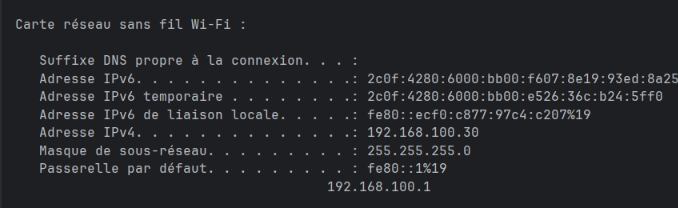

**Interprétation :** cette adresse identifie le PC serveur sur le réseau local. Les deux
machines doivent être sur le même réseau (masque 255.255.255.0).

### Test de connectivité
Depuis le PC client, j'ai testé l'accès au serveur avec `ping 192.168.100.30`.

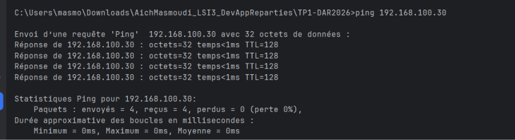

**Interprétation :** les réponses du ping montrent que les deux machines se voient sur le réseau.

### Configuration du serveur
Le serveur utilise `InetAddress` et `InetSocketAddress` pour créer un `ServerSocket`,
puis le lie à l'adresse IP réelle de la machine et au port 1234 avec `bind()`.

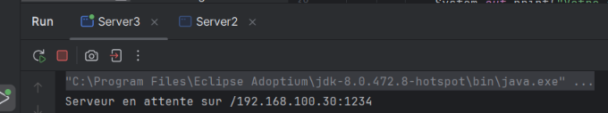

**Interprétation :** le serveur écoute sur 192.168.100.30:1234 et attend la connexion d'un client.

### Configuration du client
Le client remplace `localhost` par l'adresse IP du serveur, avec `InetAddress` et
`InetSocketAddress`, et se connecte avec un délai maximal de 5 secondes.

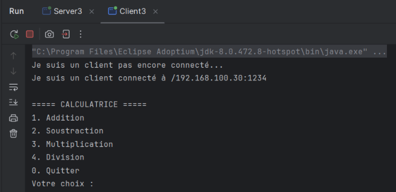

**Interprétation :** le client est connecté au serveur depuis une autre machine, et le menu
de la calculatrice s'affiche.

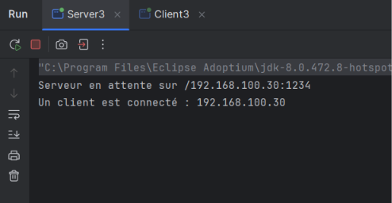

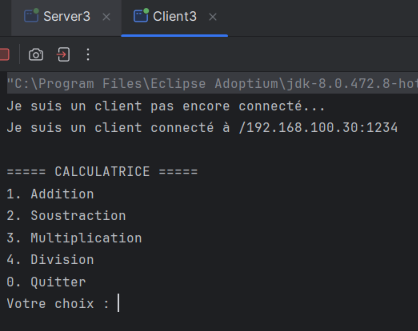

## Étape 2 : Service de calculatrice amélioré

Le client choisit une opération dans un menu (1 : addition, 2 : soustraction,
3 : multiplication, 4 : division), puis saisit deux entiers x et y. Il envoie le choix et
les deux valeurs au serveur avec `DataOutputStream`. Le serveur effectue le calcul et
renvoie le résultat. Pour la division, il renvoie une erreur si y vaut 0.

### Addition
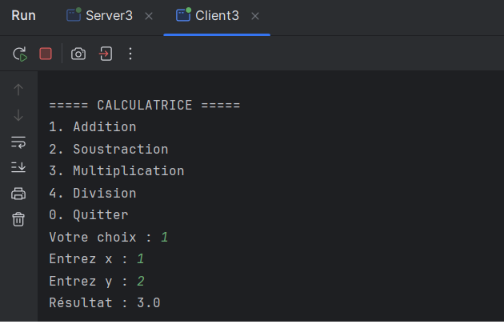

**Interprétation :** le serveur reçoit le choix 1 avec x et y, calcule x + y et renvoie le résultat.

### Soustraction
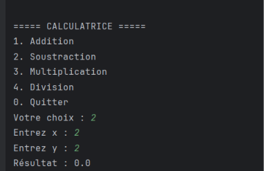

**Interprétation :** le calcul gère bien les nombres négatifs grâce à `writeInt` et `readInt`.

### Multiplication
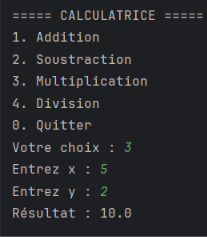

**Interprétation :** le serveur calcule x * y et renvoie le résultat.

### Division
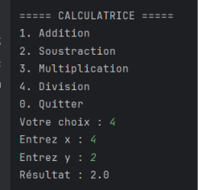

**Interprétation :** le résultat est un nombre décimal (type `double`), par exemple 10 / 4 = 2.5.

### Division par zéro
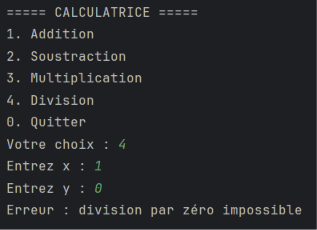

**Interprétation :** le serveur détecte y = 0 et renvoie un message d'erreur au lieu de planter.
Le client l'affiche et le menu reste disponible.

### Fin de la communication
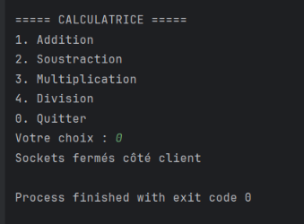
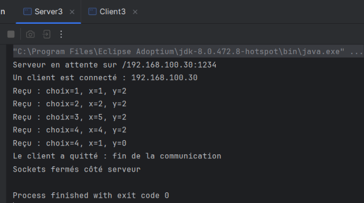

**Interprétation :** quand le client choisit 0, il l'envoie au serveur. Les deux programmes
sortent de leur boucle et ferment leurs sockets : la communication s'arrête proprement.

# Conclusion générale

Ce TP m'a permis de mettre en pratique la communication Client/Serveur en Java avec les sockets TCP en mode connecté.

- **Activité 1-1 :** création d'un serveur (`ServerSocket`) et d'un client (`Socket`) qui échangent un entier.
- **Activité 1-2 :** ajout d'un calcul côté serveur (x * 5), avec `DataInputStream` et `DataOutputStream` pour gérer les entiers négatifs, et une boucle qui s'arrête proprement à la saisie de 0.
- **Activité 1-3 :** connexion entre deux machines avec `InetAddress` et `InetSocketAddress`, et calculatrice à quatre opérations avec gestion de la division par zéro.

**Difficultés :** gestion des négatifs, ordre de lancement serveur/client, pare-feu, et utilisation de Git/GitHub.

**Limite :** le serveur ne traite qu'un seul client à la fois ; l'utilisation de threads permettrait d'en gérer plusieurs.